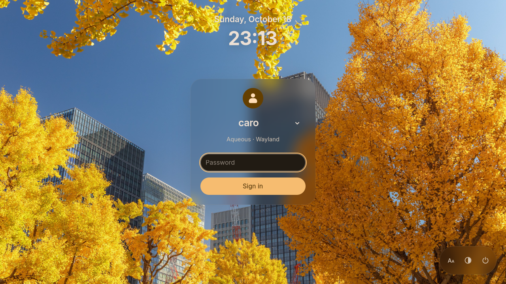

import { Aside } from "@astrojs/starlight/components";

The Pearl greeter is the login screen. It is a client for
[greetd](https://github.com/kennylevinsen/greetd), which authenticates your
login and launches the desktop you select. It shares its presentation with the
[lock screen](/pearl/docs/security/#lock-screen), but the two are different
tools: the locker unlocks an already running session, while the greeter
creates a new one.

The greeter runs on ordinary Aqueous. Its host starts a private session bus
and a standard Aqueous instance for the login screen; no special compositor
mode or patched build is required. The `pearl-greeter-git` package is
independent of the shell packages: it does not install the Pearl desktop and
does not replace Aqueous's own session entry. Every installed desktop stays
selectable, and choosing another session hands over to that desktop's own
shell, services and locker.

## Installing the package

Install `pearl-greeter-git` from the
[seafoam-labs repository](/pearl/installation/), or build it from the
repository's `packaging/arch-git` recipe, which produces both `pearl-git` and
`pearl-greeter-git` from one checkout:

```sh
cd packaging/arch-git
makepkg -s
sudo pacman -U ./pearl-greeter-git-*.pkg.tar.zst
```

The package requires Aqueous, UWSM, greetd, D-Bus, polkit and the GTK
runtime, and uses your distribution's greetd PAM policy; it installs no
separate fingerprint or locker PAM configuration.

Installation does not disturb the running desktop:

1. It creates `/etc/pearl/greeter.json`, with UWSM sessions allowed and the
   Aqueous desktop as the preferred session.
2. It provisions the dedicated `pearl-greeter` system account and its
   directories.
3. An existing `/etc/greetd/config.toml` is copied to `config.toml.bak`
   first, then replaced with Pearl's configuration, which runs greetd on VT7.
   VT1 stays available for console login.
4. It selects `pearl-greeter.service` as the display manager for the next
   boot and records the previous selection. No service is stopped or
   restarted; reboot when you are ready.

Removing the package, or running
`sudo /usr/lib/pearl/pearl-greeter-setup restore`, brings back the previous
display-manager selection and, while the configuration still matches Pearl's
template, the original greetd config. `sudo
/usr/lib/pearl/pearl-greeter-setup enable` repairs the setup after an earlier
install left another greeter, such as Ly, enabled alongside it. The full
setup and recovery behavior is documented in the [Pearl
repository](https://github.com/Seafoam-Labs/pearl/blob/main/packaging/arch-greeter/README.md).

## The login card

With account discovery enabled (the default), a dropdown lists your accounts
and **Other user…** opens manual entry. The standard flow is password-first:
type your password and press Enter to sign in. A failed attempt clears the
password, keeps your user and session selection, and refocuses the field.

Custom PAM stacks that ask for a PIN or code before the password need
`"password_first": false` in the configuration; the password field then stays
disabled until PAM actually requests it. Fingerprint logins work as passive
conversations: scan instructions and retries advance on their own, exactly as
described under [fingerprint login](/pearl/docs/security/#fingerprint-login).

The desktop chooser lists installed Wayland sessions, with localized names
and IDs such as `wayland:gnome.desktop`; X11 sessions are supported behind an
opt-in setting. The footer offers larger text, high contrast and reduced
motion for the current greeter session, and the power controls follow the
system's capabilities and ask for confirmation.

## Configuration

The greeter reads `/etc/pearl/greeter.json`, owned by root. The package
installs it, shelly preserves your changes through its backup and `.pacnew`
handling, and an invalid security-critical configuration stops startup rather
than falling back silently. After an upgrade, review any `.pacnew` file and
merge what you want with `sudoedit /etc/pearl/greeter.json`; one upgrade note
matters for authentication: configurations that omit `password_first` now
default to `true`, while an explicit `false` is preserved for custom PAM
stacks.

The settings most worth knowing:

| Setting                                         | Behavior                                                                                               |
| ----------------------------------------------- | ------------------------------------------------------------------------------------------------------ |
| `theme`, `gtk_theme`                            | `material_dark`, `material_light` or `gtk`, with an optional installed GTK theme name                  |
| `wallpaper`, `wallpaper_fit`, `wallpaper_color` | Administrator-owned PNG or JPEG background, `cover` or `contain`, optional solid color                 |
| `font_size`, `reduced_motion`                   | 12 to 32 px base font and animation policy                                                             |
| `preferred_output`, `preferred_output_edid`     | Monitor for the login card, by connector or by identity hash                                           |
| `roots`                                         | Ordered session directories, each `wayland` or `x11`; earlier entries mask later ones with the same ID |
| `default_session`, `force_session`              | Preferred session ID, or an administrator-enforced one                                                 |
| `allow`, `deny`                                 | Optional session ID lists; deny wins                                                                   |
| `remember_session`                              | Opt-in memory of the last accepted session per username; defaults off                                  |
| `allow_uwsm`                                    | Defaults true; set false to disable entries that directly invoke UWSM                                  |
| `x11`                                           | Defaults false; enabling also requires startx and the packaged X11 adapter                             |
| `accounts`, `power`, `screen_reader`            | Account discovery, permitted power controls and the screen-reader launcher                             |
| `password_first`                                | Defaults true for standard password-first PAM stacks                                                   |
| `auth_timeout_seconds`                          | 30 to 300 seconds for the attempt deadline and input inactivity                                        |

Session memory contains only username and session ID records, never
commands, environment or passwords. Remembered and configured session IDs are
resolved against the currently installed sessions, and a session whose
launcher or compositor is missing is marked unavailable instead of being
offered.

To pin the login card to a monitor by identity rather than by its current
port, run `aqueousctl outputs --json` in your desktop session and copy that
monitor's `edid_sha256` into `preferred_output_edid`. The identity wins over
the connector name, and the setting applies when the greeter next starts.

## Syncing appearance from Settings

**Settings → Appearance → Login screen → Choose image and sync** Will ask for root permissions, as the following actions writes to `etc`. The selected png/jpg is copied to `/etc/pearl/greeter-assets` and if you have Dynamic theme 
generation on will generate a matugen theme based on the selected image that
is also placed in `/etc/pearl/greeter-assets/palette.json`. If you want to apply the theme manually, you can edit the `palette.json` file.

Example of applied theme:



## Troubleshooting

If the greeter does not appear after a reboot, follow the greeter runbook in
the [Pearl repository's logging
guide](https://github.com/Seafoam-Labs/pearl/blob/main/docs/LOGGING.md): check
that `pearl-greeter.service` is the selected display manager, that VT7 is
free, and that `/etc/greetd/config.toml` matches Pearl's template. A masked or
custom display-manager unit makes automatic setup report a failure instead of
replacing it; resolve that unit, then rerun `sudo
/usr/lib/pearl/pearl-greeter-setup enable`.

<Aside type="note">
  Never type real credentials into a preview or test instance of the greeter.
  Authentication only works against the real greetd service, and the login
  card's discovery of an account never grants access by itself.
</Aside>
